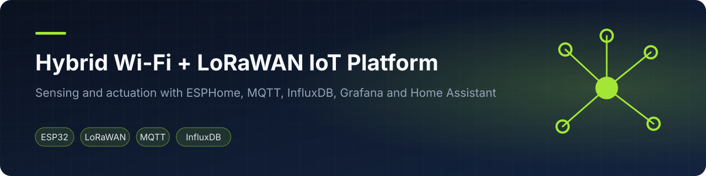
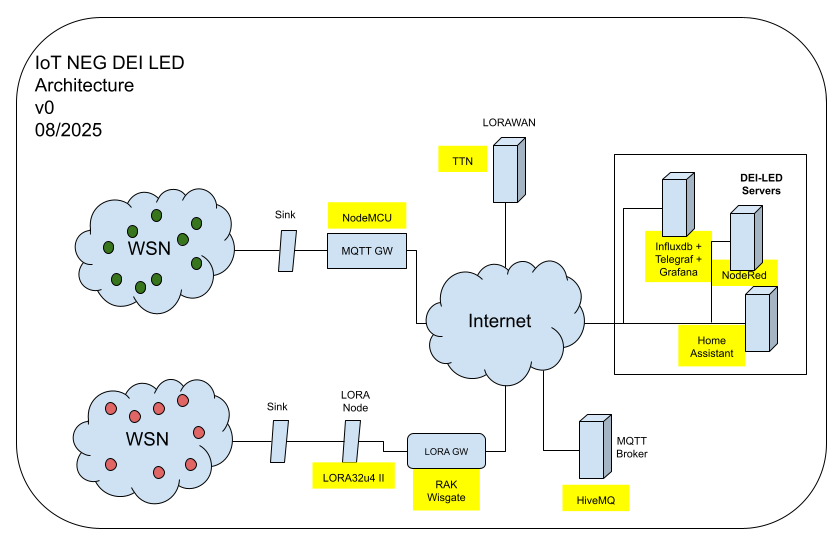
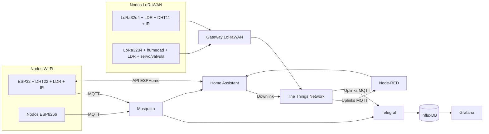

<p align="center"></p>

<p align="center">      </p>
<p align="center"><a href="#english">English</a> · <a href="#español">Español</a></p>

## English

### Overview
This project combines sensing and actuation in a hybrid IoT network with two radio technologies: Wi-Fi nodes (ESP8266, ESP32) and LoRaWAN nodes (Heltec LoRa32u4). Both families feed a common backend running on a repurposed older PC with Linux: an MQTT broker, a time-series database, dashboards and a home-automation layer. New nodes, sensors and data flows can be added to the shared platform. Each team member contributed an independent node implementation.

### Scope of this repository
This repository contains the documentation and the device-side work that team members uploaded. The backend stack (MQTT broker, InfluxDB, Telegraf, Grafana, Node-RED flows and the TTN integration) ran on the faculty's DEI-LED server; its live configuration stays there and was not exported, so those folders hold setup notes rather than deployable configs. Some per-member implementations are partial because not every member uploaded their final files.

| Part | Status in this repository |
|---|---|
| ESPHome IR/sensor node and air-conditioning control (Elías Álvarez) | Complete: configs, automations and docs |
| Python/Arduino IR and ultrasonic scripts (Matías, Elías) | Complete |
| Docker stack and perfume dispenser (Erick Wu) | Configs with secrets replaced by placeholders |
| LoRa nodes (Joel Cañete, Tania) | Partial: sketches and notes as uploaded |
| MQTT, InfluxDB, Telegraf, Grafana, Node-RED, TTN backend | Setup documentation only; deployed on the DEI-LED server |

### Highlights
- Hybrid architecture: Wi-Fi nodes publish to a local Mosquitto broker; LoRaWAN nodes reach The Things Network (TTN) and are consumed over TTN's MQTT interface.
- Backend stack: Mosquitto (MQTT), Telegraf, InfluxDB, Grafana, Node-RED, Home Assistant and ESPHome, deployed with Docker.
- Remote air-conditioner control: IR codes captured in raw mode with a TL1838 receiver and re-emitted from an ESP32 through ESPHome (on/off at 24 C), triggered by Home Assistant automations.
- LoRaWAN node with servo (curtain) and valve actuation driven by humidity, with downlinks sent from Home Assistant; a secondary Arduino drives the servos because the LoRa board cannot run LMIC and Servo together.
- Wi-Fi perfume dispenser node (ESP8266) with MQTT status/command topics, Telegram bot control and automatic broker selection per network.
- Documentation per component (MQTT, InfluxDB, Grafana, Node-RED, Home Assistant, ESPHome, TTN, LoRa), written in Spanish, plus three step-by-step guides in `docs/`.

### System architecture
<p align="center"></p>


### Hardware
| Component | Role |
|---|---|
| ESP32 (ESPHome) | Wi-Fi node: DHT22, LDR, IR receiver (TL1838) and IR LED for air-conditioner control |
| ESP8266 | Wi-Fi nodes: ultrasonic sensor (HC-SR04), IR resend sketches, perfume dispenser, ESPHome virtual node |
| Heltec LoRa32u4 | LoRaWAN OTAA nodes: LDR, DHT11, IR obstacle sensor, humidity, servo/valve commands |
| Arduino (slave) | Drives servos on commands from the LoRa node |
| LoRaWAN gateway + TTN | Radio uplink/downlink and network server |
| Linux server (Docker) | Mosquitto, Telegraf, InfluxDB, Grafana, Node-RED, Home Assistant, ESPHome |

### Repository layout
```
MQTT/            Mosquitto broker notes and TTN MQTT behaviour
Telegraf/        MQTT -> InfluxDB agent
InfluxDB/        Time-series database
Grafana/         Dashboards
NodeRed/         Flow-based integration (TTN uplink -> dashboard), screenshots
homeassistant/   Home Assistant setup, AC control automations, TTN downlink notes
esphome/         ESPHome guide, secrets.example.yaml, per-member node configs
  Implementaciones/Elias     ESP32 sensor + IR node (aula_sensors)
  Implementaciones/Erick     Docker compose, ESPHome and Grafana provisioning
  Implementaciones/Matias    ESP8266 virtual temperature node
LoRa/            LoRa hardware choice and per-member LoRaWAN nodes
  Implementaciones/Joel      LoRa32u4 node with LDR + DHT11 + IR
  Implementaciones/Tania     LoRa32u4 node with servo/valve + slave Arduino
TTN/             The Things Network application/device setup
Scripts/         Helper tools: IR calibration and Python (matias-elias), dispenser firmware (erick)
docs/            Step-by-step guides (PDF)
```

### Getting started
1. Provision a Linux host with Docker and start the stack from `esphome/Implementaciones/Erick/docker-compose.yml` (Mosquitto, Telegraf, InfluxDB, Grafana); see `Scripts/erick/readme.md`.
2. Copy `esphome/secrets.example.yaml` to `esphome/secrets.yaml` and fill in your values. Replace every `<PLACEHOLDER>` in the YAML and sketches (Wi-Fi, broker IP, TTN keys, tokens).
3. Flash Wi-Fi nodes with ESPHome (`esphome/README.md`) or with the Arduino sketches in `Scripts/`.
4. For LoRaWAN nodes, register the device in TTN (`TTN/README.md`), put the DevEUI and AppKey in the sketch under `LoRa/Implementaciones/` and flash it with the Arduino IDE (LMIC).
5. Connect Node-RED or Telegraf to the TTN MQTT interface using an API key (`NodeRed/README.md`, `MQTT/TTN-MQTT/README.md`).

Secrets (Wi-Fi credentials, TTN keys, bot tokens, server IPs) were removed from this public copy and replaced with placeholders.

### Results
- Node-RED dashboard fed by TTN uplinks (`NodeRed/node-red-dashboard.jpg`, `NodeRed/node-red-esquema.jpg`).
- Air-conditioner on/off automations in Home Assistant (`homeassistant/Control_de_AACC/Automations/`).

### Team & credits
Developed by Elías David Álvarez Martínez (ESP32 sensor/IR node, AC control, scripts), Matías Franco (ESP8266 virtual node, ultrasonic sensor and IR scripts), Erick Wu (Docker stack, perfume dispenser, step-by-step guide), Víctor Joel Cañete Barboza (LoRaWAN LDR/DHT11/IR node, guide) and Tania Romero (LoRaWAN humidity/servo/valve node, guide) at Universidad Católica "Nuestra Señora de la Asunción" (Paraguay), 2025, with Eng. Fernando Brunetti, PhD, as advisor.

### License
MIT. Technical guides and figures are shared for reference.

---

## Español

### Descripción general
Este proyecto combina sensado y actuación en una red IoT híbrida con dos tecnologías de radio: nodos Wi-Fi (ESP8266, ESP32) y nodos LoRaWAN (Heltec LoRa32u4). Ambas familias alimentan un backend común sobre una PC reutilizada con Linux: broker MQTT, base de datos de series temporales, dashboards y capa de automatización. La plataforma admite nuevos nodos, sensores y flujos de datos. Cada integrante aportó una implementación de nodo independiente.

### Puntos destacados
- Arquitectura híbrida: los nodos Wi-Fi publican a un broker Mosquitto local; los nodos LoRaWAN llegan a The Things Network (TTN) y se consumen por su interfaz MQTT.
- Stack de backend: Mosquitto, Telegraf, InfluxDB, Grafana, Node-RED, Home Assistant y ESPHome, desplegado con Docker.
- Control remoto de aire acondicionado: códigos IR capturados en modo raw con un receptor TL1838 y reemitidos desde un ESP32 con ESPHome (encendido/apagado a 24 C), activados por automatizaciones de Home Assistant.
- Nodo LoRaWAN con servo (cortina) y válvula según humedad, con downlinks desde Home Assistant; un Arduino secundario maneja los servos porque la placa LoRa no soporta LMIC y Servo a la vez.
- Nodo dispensador de perfumes (ESP8266) con tópicos MQTT de estado/comando, control por bot de Telegram y selección automática de broker según la red.
- Documentación por componente (en español) y tres guías paso a paso en `docs/`.

### Alcance de este repositorio
Este repositorio contiene la documentación y el trabajo de dispositivos que subieron los integrantes. El backend (broker MQTT, InfluxDB, Telegraf, Grafana, flujos de Node-RED e integración con TTN) corrió en el servidor DEI-LED de la facultad; su configuración en uso quedó allí y no se exportó, por lo que esas carpetas contienen notas de instalación y no configuraciones desplegables. Algunas implementaciones individuales están incompletas porque no todos los integrantes subieron sus archivos finales.

| Parte | Estado en este repositorio |
|---|---|
| Nodo IR/sensores ESPHome y control de aire acondicionado (Elías Álvarez) | Completo: configuraciones, automatizaciones y documentación |
| Scripts IR y ultrasónicos en Python/Arduino (Matías, Elías) | Completo |
| Stack Docker y dispensador de perfume (Erick Wu) | Configuraciones con secretos reemplazados por marcadores |
| Nodos LoRa (Joel Cañete, Tania) | Parcial: sketches y notas tal como fueron cargados |
| Backend MQTT, InfluxDB, Telegraf, Grafana, Node-RED, TTN | Solo documentación de instalación; desplegado en el servidor DEI-LED |

### Arquitectura del sistema
<p align="center"></p>



### Hardware
| Componente | Función |
|---|---|
| ESP32 (ESPHome) | Nodo Wi-Fi: DHT22, LDR, receptor IR (TL1838) y LED IR para controlar el aire acondicionado |
| ESP8266 | Nodos Wi-Fi: sensor ultrasónico (HC-SR04), sketches de retransmisión IR, dispensador de perfume, nodo virtual ESPHome |
| Heltec LoRa32u4 | Nodos LoRaWAN OTAA: LDR, DHT11, sensor IR de obstáculos, humedad, comandos de servo/válvula |
| Arduino (esclavo) | Acciona los servos según los comandos del nodo LoRa |
| Gateway LoRaWAN + TTN | Uplink/downlink de radio y servidor de red |
| Servidor Linux (Docker) | Mosquitto, Telegraf, InfluxDB, Grafana, Node-RED, Home Assistant, ESPHome |

### Estructura del repositorio
```
MQTT/            Notas del broker Mosquitto y comportamiento MQTT de TTN
Telegraf/        Agente MQTT -> InfluxDB
InfluxDB/        Base de datos de series temporales
Grafana/         Dashboards
NodeRed/         Integración basada en flujos (uplink TTN -> dashboard), capturas
homeassistant/   Instalación de Home Assistant, automatizaciones del aire acondicionado, notas de downlink TTN
esphome/         Guía ESPHome, secrets.example.yaml, configuraciones de nodos por integrante
  Implementaciones/Elias     Nodo ESP32 con sensores + IR (aula_sensors)
  Implementaciones/Erick     Docker compose, aprovisionamiento ESPHome y Grafana
  Implementaciones/Matias    Nodo virtual de temperatura ESP8266
LoRa/            Selección de hardware LoRa y nodos LoRaWAN por integrante
  Implementaciones/Joel      Nodo LoRa32u4 con LDR + DHT11 + IR
  Implementaciones/Tania     Nodo LoRa32u4 con servo/válvula + Arduino esclavo
TTN/             Configuración de aplicación/dispositivo en The Things Network
Scripts/         Herramientas auxiliares: calibración IR y Python (matias-elias), firmware del dispensador (erick)
docs/            Guías paso a paso (PDF)
```

### Puesta en marcha
1. Preparar un servidor Linux con Docker y levantar el stack con `esphome/Implementaciones/Erick/docker-compose.yml`; ver `Scripts/erick/readme.md`.
2. Copiar `esphome/secrets.example.yaml` a `esphome/secrets.yaml` y completarlo. Reemplazar cada `<PLACEHOLDER>` en los YAML y sketches (Wi-Fi, IP del broker, claves TTN, tokens).
3. Cargar los nodos Wi-Fi con ESPHome (`esphome/README.md`) o con los sketches de `Scripts/`.
4. Para los nodos LoRaWAN, registrar el dispositivo en TTN (`TTN/README.md`), colocar DevEUI y AppKey en el sketch de `LoRa/Implementaciones/` y cargarlo con Arduino IDE (LMIC).
5. Conectar Node-RED o Telegraf a la interfaz MQTT de TTN con una API key (`NodeRed/README.md`, `MQTT/TTN-MQTT/README.md`).

Los secretos (credenciales Wi-Fi, claves TTN, tokens, IPs de servidores) fueron eliminados de esta copia pública y reemplazados por marcadores.

### Resultados
- Dashboard de Node-RED alimentado por uplinks de TTN (`NodeRed/node-red-dashboard.jpg`, `NodeRed/node-red-esquema.jpg`).
- Automatizaciones de encendido/apagado del aire acondicionado en Home Assistant (`homeassistant/Control_de_AACC/Automations/`).

### Equipo y créditos
Desarrollado por Elías David Álvarez Martínez (nodo ESP32 con sensores/IR, control del aire acondicionado, scripts), Matías (nodo virtual ESP8266, sensor ultrasónico y scripts IR), Erick Wu (stack Docker, dispensador de perfume, guía paso a paso), Víctor Joel Cañete Barboza (nodo LoRaWAN LDR/DHT11/IR, guía) y Tania (nodo LoRaWAN de humedad/servo/válvula, guía) en la Universidad Católica "Nuestra Señora de la Asunción" (Paraguay), 2025, con Eng. Fernando Brunetti, PhD, como asesor.

### Licencia
MIT. Las guías técnicas y figuras se comparten como referencia.
